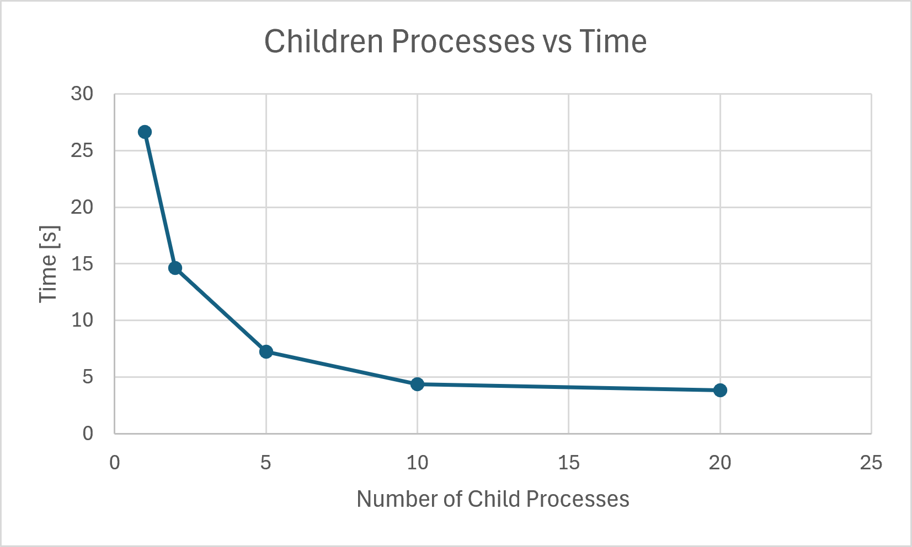

# Multiprocessing Lab

## Implementation Overview

The Mandelbrot program was modified to generate 50 images using multiprocessing. The fork() function creates child processes. The wait() function waits for a child process to finish before creating another child process when the process limit is reached. Each child generates an image with a progressively smaller scale. The images are combined into a .mp4 using FFmpeg.
## Runtime Results

As the number of child processes increased, the time the program took to generate 50 images decreased. 